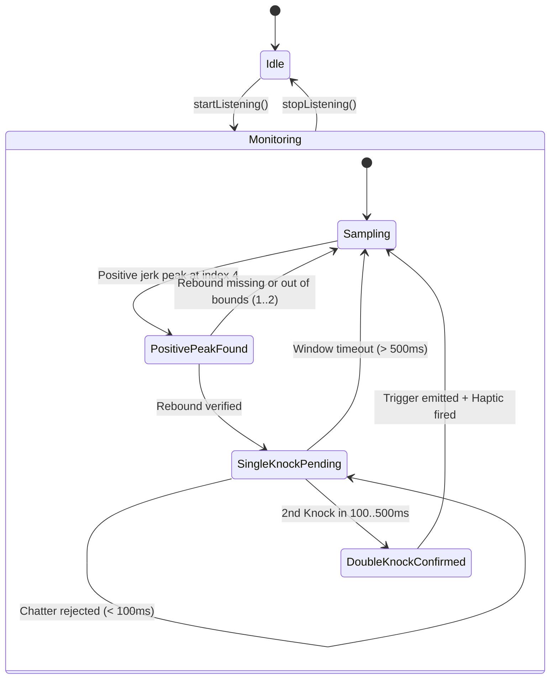

# Data Model: Heuristic Knock Detection

## Entities & Value Objects

### 1. `RawSensorSample`

Represents an individual motion sensor event received from the hardware accelerometer.

| Field | Type | Description |
|---|---|---|
| `x` | `Float` | Lateral acceleration ($m/s^2$) |
| `y` | `Float` | Longitudinal acceleration ($m/s^2$) |
| `z` | `Float` | Perpendicular (screen/back) acceleration ($m/s^2$) |
| `timestampNs` | `Long` | Hardware event timestamp in nanoseconds |

**Validation Rules**:
- Timestamps must be strictly monotonically increasing.
- Acceleration magnitudes must be within valid device sensor ranges ($\pm 4g$ to $\pm 16g$).

---

### 2. `JerkSignalPoint`

Represents the time derivative of acceleration ($\Delta a / \Delta t$) along the target sensing axis.

| Field | Type | Description |
|---|---|---|
| `jerkZ` | `Float` | Rate of acceleration change on the Z-axis |
| `filteredKey` | `Float` | Bandpass-filtered signal value |
| `timestampNs` | `Long` | Sample timestamp in nanoseconds |

---

### 3. `PeakEvent`

Represents an identified local extrema in the filtered jerk signal.

| Field | Type | Description |
|---|---|---|
| `amplitude` | `Float` | Peak magnitude |
| `windowIndex` | `Int` | Index within the rolling analysis window |
| `polarity` | `PeakPolarity` | `POSITIVE_IMPACT` or `NEGATIVE_REBOUND` |
| `timestampNs` | `Long` | Detection timestamp |

---

### 4. `KnockImpulse`

Represents a validated single tap event matching physical impact mechanics.

| Field | Type | Description |
|---|---|---|
| `timestampNs` | `Long` | Time of the detected impact |
| `impactPeakId` | `Int` | Window index of positive peak (must equal 4) |
| `reboundDelta` | `Int` | Interval between positive and negative peaks ($1 \le \Delta \le 2$) |

**Validation Rules**:
- A single knock is valid if and only if `positiveIdMajorPeak == 4` and `negativeIdMajorPeak - positiveIdMajorPeak` is in $[1, 2]$.

---

### 5. `DoubleKnockEvent`

Represents the validated dual-knock gesture that triggers audio capture.

| Field | Type | Description |
|---|---|---|
| `firstKnockNs` | `Long` | Timestamp of first knock impulse |
| `secondKnockNs` | `Long` | Timestamp of second knock impulse |
| `intervalMs` | `Long` | Elapsed time between knocks ($100\text{ ms} \le \text{interval} \le 500\text{ ms}$) |

---

### 6. `HeuristicEvaluationMetrics`

Represents telemetry data collected during accuracy and satisfaction testing.

| Field | Type | Description |
|---|---|---|
| `totalSensorEvents` | `Long` | Count of processed accelerometer readings |
| `positivePeaksDetected` | `Int` | Count of detected positive impact spikes |
| `reboundMatches` | `Int` | Count of verified rebound pairs |
| `doubleKnocksTriggered` | `Int` | Total capture events fired |
| `suppressedChatterCount` | `Int` | Events rejected by debounce (< 100ms) |
| `timedOutKnocksCount` | `Int` | Solitary knocks where no 2nd knock arrived (< 500ms) |

---

## State Transitions

