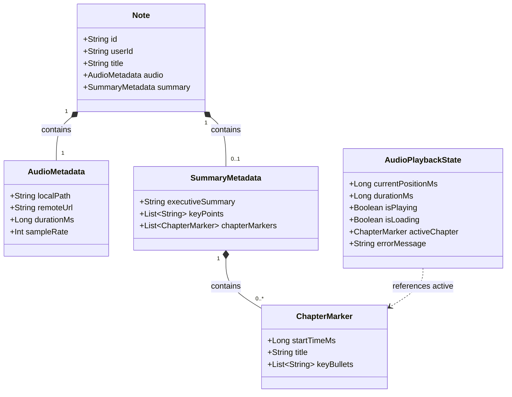
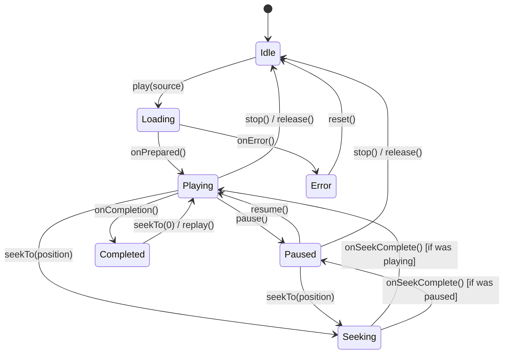

# Data Model: Audio Playback with Interactive Chapters

This document describes domain entities, state representations, validation rules, and state transitions for audio playback and chapter navigation.

## 1. Domain Entities & Value Objects

### Entity: `AudioPlaybackState`

Represents the observable UI state of the playback engine at any given moment.

| Field | Type | Description | Constraints |
|---|---|---|---|
| `currentPositionMs` | `Long` | Current playback timestamp | $0 \le \text{currentPositionMs} \le \text{durationMs}$ |
| `durationMs` | `Long` | Total audio track length | $\ge 0$ |
| `isPlaying` | `Boolean` | True if audio is actively playing | Mutually exclusive with `isLoading` |
| `isLoading` | `Boolean` | True while loading or preparing media source | Initial state before playback starts |
| `activeChapter` | `ChapterMarker?` | The chapter covering `currentPositionMs` | Null if note has no chapters |
| `errorMessage` | `String?` | Human-readable playback failure message | Null on normal operation |

---

### Entity: `ChapterMarker` (Existing)

A structured section of note audio generated by AI summarization or specified manually.

| Field | Type | Description | Constraints |
|---|---|---|---|
| `startTimeMs` | `Long` | Start timestamp in milliseconds from recording start | $\ge 0$, strictly ordered ascending |
| `title` | `String` | Chapter title heading | Non-empty, under 60 characters |
| `keyBullets` | `List<String>` | Summary points covered in this chapter | At least 1 item per chapter |

---

## 2. State Machine Transitions

### Transition Validation Rules

1. **Duration Boundary**: Any seek request where $\text{targetPositionMs} > \text{durationMs}$ clamps to $\text{durationMs}$.
2. **Lower Boundary**: Any seek request where $\text{targetPositionMs} < 0$ clamps to $0$.
3. **Active Chapter Computation**: The active chapter is uniquely determined by:
   $$\text{activeChapter} = \max_{\text{startTimeMs} \le \text{currentPositionMs}} \{ m \in \text{chapterMarkers} \}$$
4. **Missing File Fallback**: If the audio file does not exist on disk, transitions immediately to `Error` state with a descriptive message.
