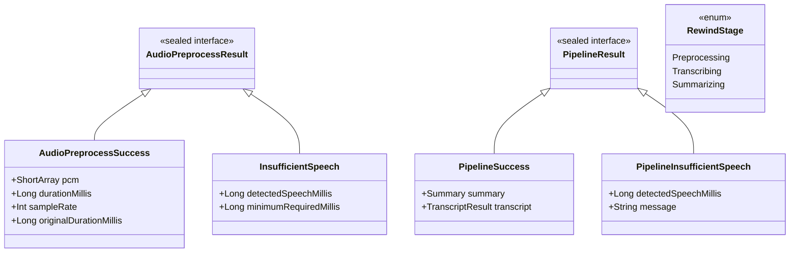
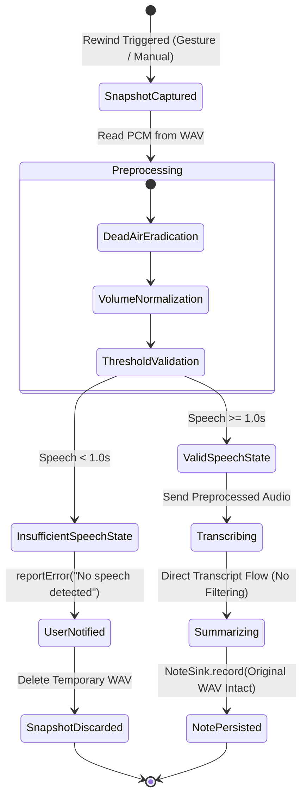

# Data Model: Audio Pre-Processing & Pipeline Entities

**Feature**: `008-audio-preprocessing`  
**Date**: 2026-10-31  
**Status**: Completed

## 1. Core Domain Entities

### 1.1 `AudioPreprocessResult`
Represents the outcome of the audio pre-processing phase executed prior to AI model invocation.

- **`Success`**:
  - `pcm: ShortArray` — Normalized, dead-air-eradicated 16 kHz 16-bit PCM audio samples.
  - `durationMillis: Long` — Effective duration of the pre-processed audio buffer.
  - `sampleRate: Int` — Sample rate in Hz (default `16_000`).
  - `originalDurationMillis: Long` — Duration of the original input buffer before dead air removal.
- **`InsufficientSpeech`**:
  - `detectedSpeechMillis: Long` — Total active speech duration detected in milliseconds (strictly `< 1000L`).
  - `minimumRequiredMillis: Long` — Threshold required to proceed with AI processing (`1000L`).

### 1.2 `PipelineResult`
Represents the terminal output of `RewindPipeline.run()`.

- **`Success`**:
  - `summary: Summary` — Generated AI summary containing title, gist, key points, and chapter markers.
  - `transcript: TranscriptResult` — Full verbatim transcript produced by the transcription engine.
- **`InsufficientSpeech`**:
  - `detectedSpeechMillis: Long` — Spoken audio duration in milliseconds detected prior to skipping.
  - `message: String` — Human-readable user notification text explaining why processing and saving were skipped.

### 1.3 `RewindStage`
Tracks current pipeline progress for UI state observation:
- `Preprocessing`: Audio dead air eradication and volume normalization running.
- `Transcribing`: Speech-to-text transcription engine running on pre-processed audio.
- `Summarizing`: Large language model generating recap from the transcript.

---

## 2. Entity Lifecycle & State Transitions

## 3. Data Integrity & Preservation Rules

1. **Original Snapshot Immutability**: The WAV file written by `LocalAudioRingBuffer.snapshot()` is never overwritten, truncated, or modified by the preprocessor.
2. **ShortArray Lifecycle**: Temporary pre-processed PCM arrays are zero-filled upon completion of the transcription step in a `finally` block to prevent lingering audio in memory.
3. **Database Consistency**: When `InsufficientSpeech` occurs, neither `NoteRepository` nor `RecentsRepository` write records.
