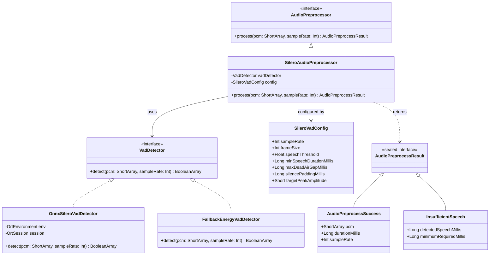
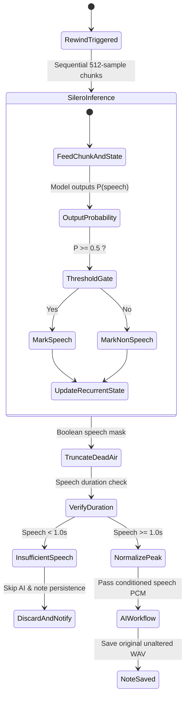

# Data Model: Silero VAD Audio Pre-Processing Entities

**Feature**: `009-silero-vad-preprocessing`  
**Date**: 2026-10-31  
**Status**: Completed

## 1. Core Domain Entities

### 1.1 `VadDetector`
Interface defining voice activity classification over raw audio PCM samples.

- **`detect(pcm: ShortArray, sampleRate: Int): BooleanArray`**:
  - Evaluates the input PCM audio and returns a boolean array where each entry indicates whether corresponding 32 ms (512-sample) audio chunks contain active human speech.

### 1.2 `SileroVadConfig`
Configuration parameters governing Silero neural inference, dead air truncation, and volume normalization.

- `sampleRate: Int = 16_000` — Expected audio sample rate in Hz.
- `frameSize: Int = 512` — Frame size in samples (~32 ms at 16 kHz).
- `speechThreshold: Float = 0.5f` — Minimum confidence probability to classify a frame as speech.
- `minSpeechDurationMillis: Long = 1_000L` — Minimum speech duration required to proceed with AI processing.
- `maxDeadAirGapMillis: Long = 1_500L` — Silent interval limit before truncating dead air.
- `silencePaddingMillis: Long = 300L` — Ambient silence retained around speech segments.
- `targetPeakAmplitude: Short = 29_490` — Target peak sample amplitude for volume normalization (~ -1 dBFS).

### 1.3 `SileroAudioPreprocessor`
Implements `AudioPreprocessor`.
- Ingests raw recorded PCM audio.
- Obtains speech classification mask from `VadDetector`.
- Truncates non-speech gaps exceeding `maxDeadAirGapMillis` to `silencePaddingMillis`.
- Rejects audio with total speech duration below `minSpeechDurationMillis` (`InsufficientSpeech`).
- Scales peak amplitude to `targetPeakAmplitude` and returns conditioned PCM in `Success`.

---

## 2. State Lifecycle

